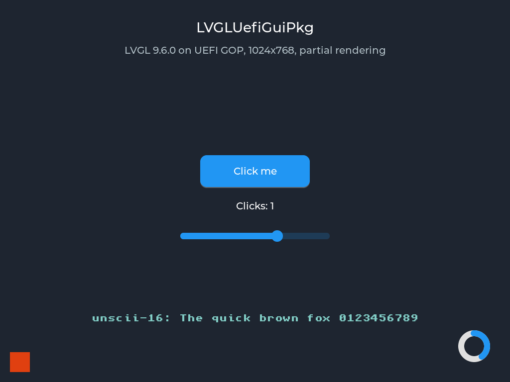
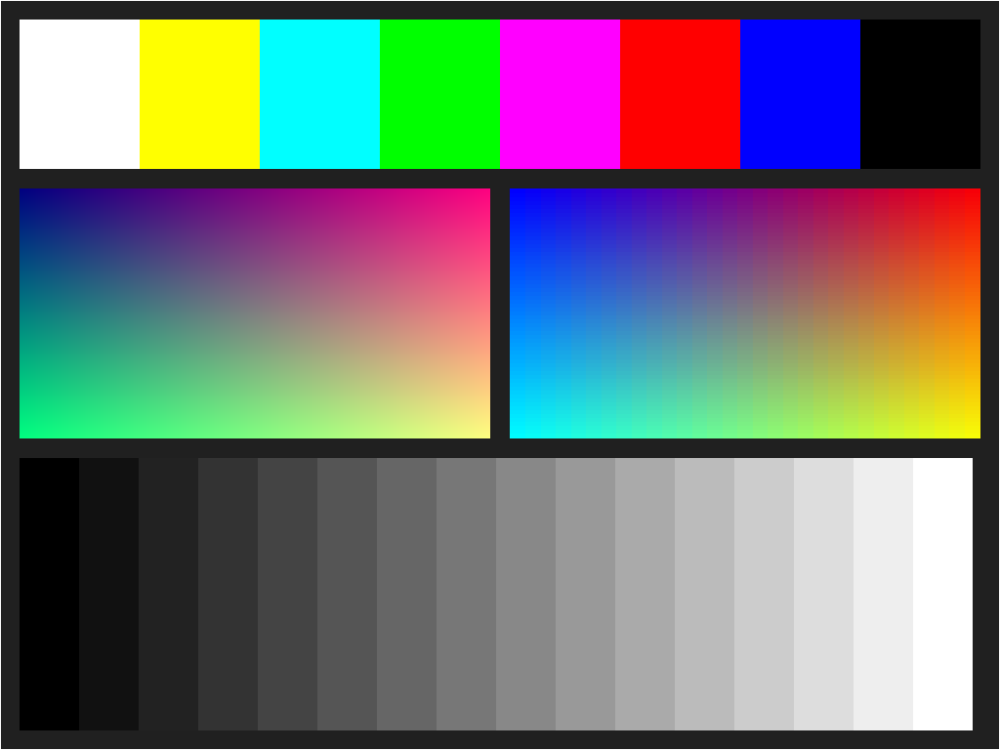

# LVGLUefiGuiPkg

Reusable LVGL v9 GUI framework for EDK2 UEFI Shell applications.

LVGLUefiGuiPkg is a standard EDK2 package. It provides the UEFI platform
layer for [LVGL](https://github.com/lvgl/lvgl) (GOP display, keyboard, mouse,
timers, memory) as EDK2 library classes, so several independent UEFI
applications (UefiNotepad, diagnostic and configuration tools) can share one
tested GUI port. LVGL provides the widgets, rendering, layout and themes;
each application owns its own logic and data model.

## Status

Development happens in phases. A phase is complete only when it builds with
both supported toolchains and its tests pass in CI.

| Phase | Content | Status |
|---|---|---|
| 0 | Package skeleton: DEC/DSC/INF, library class headers, memory backend, UefiGuiHello | Done (GCC build + QEMU smoke test, VS2022 build) |
| 1 | GOP display backend (Blt path, all pixel formats, PixelBltOnly) + GopTest | Done (GCC + QEMU GopTest with screenshot, VS2022 build) |
| 2 | LVGL v9.6.0 integration (partial rendering, flush lifecycle, time base, timer loop) + LvglPortTest | Done (GCC + QEMU LvglPortTest with screenshot, VS2022 build) |
| 3 | Keyboard backend (Simple Text Input Ex) and LVGL keypad indev | Not started |
| 4 | Pointer backend (Simple / Absolute Pointer) and LVGL pointer indev | Not started |
| 5 | Event loop and timers without busy polling; UefiGuiDemo | Not started |
| 6 | Performance and stability measurements | Not started |

Validation so far is in QEMU with OVMF only (GOP format BGR8). PixelBltOnly,
RGB8 and PixelBitMask are covered with synthetic GOP instances in GopTest.
Nothing has been validated on real hardware yet.





## Supported environment

| | |
|---|---|
| EDK2 | edk2-stable202608 |
| Architecture | X64 |
| Toolchains | `GCC` (Linux, GCC 5+), `VS2022` (Windows) |
| LVGL | v9.6.0 (git submodule `Library/LvglLib/lvgl`; clone with `--recursive`) |
| Runs on | UEFI Shell, standalone `.efi`, no OS dependency |

## Layout

```text
LVGLUefiGuiPkg/
├── LVGLUefiGuiPkg.dec / .dsc     Package declaration and build description
├── Include/
│   ├── Library/                  Library class headers (public API)
│   │   ├── UefiGuiLib.h          Framework API used by applications
│   │   ├── UefiGuiDisplayLib.h   GOP display backend
│   │   ├── UefiGuiInputLib.h     Keyboard/pointer backends, input queue
│   │   ├── UefiGuiRuntimeLib.h   Memory and time base
│   │   └── LvglLib.h             Includes <lvgl.h>
│   └── UefiGui/                  Shared types, configuration, error helpers
├── Library/
│   ├── UefiGuiRuntimeLib/        Memory backend (Phase 0), TSC time base (Phase 2)
│   ├── UefiGuiDisplayLib/        GOP display backend: Blt + optional frame buffer (Phase 1)
│   ├── LvglLib/                  LVGL v9.6.0 submodule, lv_conf.h, freestanding shims (Phase 2)
│   └── UefiGuiLib/               Public API, LVGL display port, event loop (Phase 2)
├── Application/
│   └── UefiGuiHello/             Phase 0 smoke test
├── Test/
│   ├── GopTest/                  Phase 1 display test (unit checks + test screen)
│   └── LvglPortTest/             Phase 2 LVGL port test (Button + Label, partial rendering)
├── scripts/                      build.sh, build.bat, run-qemu.sh, gen-lv-conf.py, gen-lvgl-inf.py
└── Docs/                         Architecture.md, BuildGuide.md
```

## Quick build

Linux:

```sh
git clone --recursive https://github.com/weinet000210/LVGLUefiGuiPkg.git
EDK2_DIR=~/edk2 LVGLUefiGuiPkg/scripts/build.sh DEBUG
LVGLUefiGuiPkg/scripts/run-qemu.sh Build-ws/Build/LVGLUefiGuiPkg/DEBUG_GCC/X64/UefiGuiHello.efi
```

Windows (VS2022):

```bat
git clone --recursive https://github.com/weinet000210/LVGLUefiGuiPkg.git
set EDK2_DIR=C:\src\edk2
set NASM_PREFIX=C:\Program Files\NASM\
LVGLUefiGuiPkg\scripts\build.bat DEBUG
```

See [Docs/BuildGuide.md](Docs/BuildGuide.md) for the full setup and
[Docs/Architecture.md](Docs/Architecture.md) for the design.

## License

LVGLUefiGuiPkg is licensed under BSD-2-Clause-Patent (see [LICENSE](LICENSE)).
LVGL is MIT licensed; its license and copyright notices are kept unchanged in
its own source tree.
